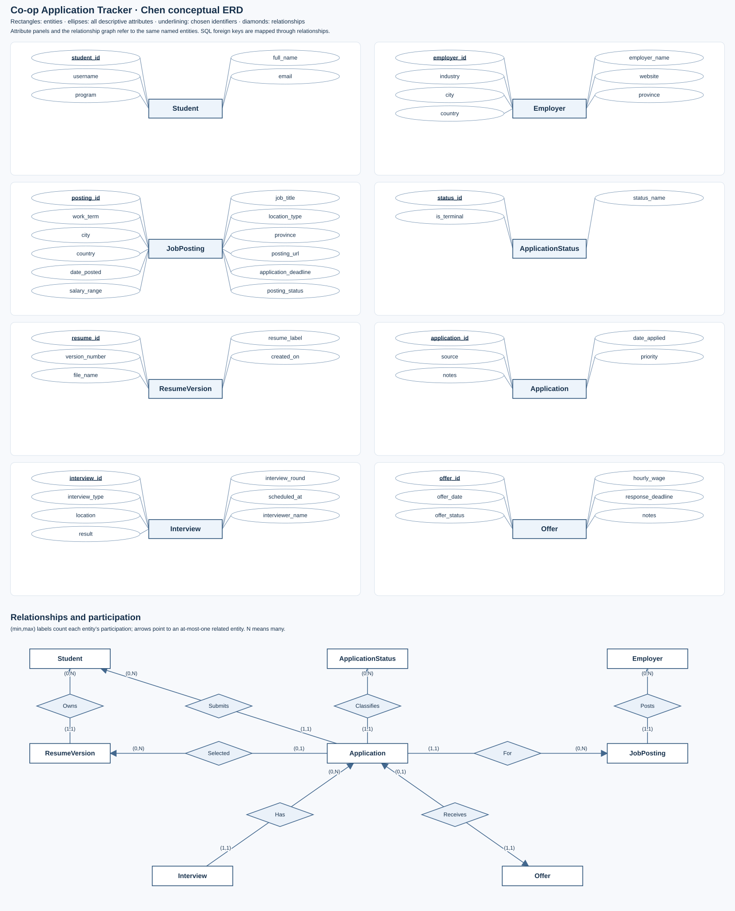

# Conceptual ERD in the course's Chen notation

This diagram uses Chen notation with entity rectangles, descriptive-attribute ellipses, underlined identifiers and relationship diamonds. It complements the complete relational diagram in `ERD.svg`; that relational diagram is not presented as a substitute for the conceptual model.

There are eight conceptual entity sets with all 50 descriptive attributes/identifiers shown. The nine SQL FK columns are represented by the eight relationships below, giving full coverage of the 59 attributes in the relational schema. A pure assignment table is the logical implementation of the Selected relationship, not a ninth independent conceptual entity.

| Conceptual relationship | SQL reference columns / implementation | Participation per entity |
| --- | --- | --- |
| Employer Posts JobPosting | JobPosting.employer_id | Employer (0,N), JobPosting (1,1) |
| Student Owns ResumeVersion | ResumeVersion.student_id | Student (0,N), ResumeVersion (1,1) |
| Student Submits Application | Application.student_id | Student (0,N), Application (1,1) |
| Application For JobPosting | Application.posting_id | Application (1,1), JobPosting (0,N) |
| ApplicationStatus Classifies Application | Application.status_id | ApplicationStatus (0,N), Application (1,1) |
| Application Has Interview | Interview.application_id | Application (0,N), Interview (1,1) |
| Application Receives Offer | Offer.application_id | Application (0,1), Offer (1,1) |
| Application Selected ResumeVersion | ApplicationResume.application_id, ApplicationResume.resume_id; application_id is the relationship key | Application (0,1), ResumeVersion (0,N) |

Participation labels count how many times one instance of the adjacent entity can participate in that relationship. An arrow points to a related entity that is unique for a given entity on the other side. This differs from the endpoint-reading convention of the companion crow's-foot diagram; use each diagram's legend.

Application is an entity with its own identifier because it has lifecycle attributes and participates in Interview and Offer relationships; its unique student/posting pair also models a student's many-to-many application association with job postings. Independent binary links are sufficient: status and selected resume belong to an application, not to a free-standing student/posting/resume ternary relationship. A hypothetical ternary choice would require uniqueness of the student/posting pair, not merely of the entire triple, to enforce one application per posting.

Interview uses its surrogate interview_id in the implemented model, with the alternate identifier (application, interview_round) documented. The weak-entity alternative and the decision against unnecessary inheritance are in `docs/CONSTRAINTS.md`.

Generate and check with `python3 scripts/conceptual_erd.py`. The complete relational schema records SQL types, nullable fields, alternate keys and FKs separately, keeping conceptual relationships separate from SQL implementation details.
