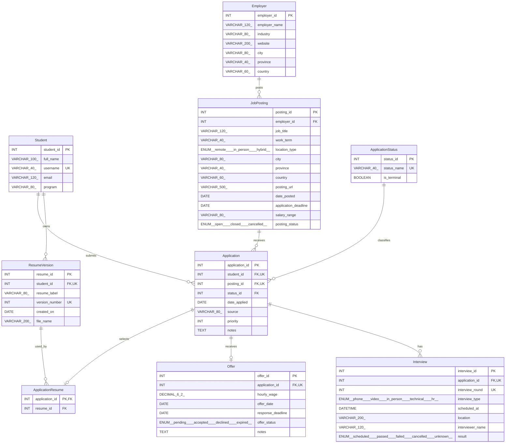

# Complete ERD - Sprint 1

Crow's-foot notation replaces the incomplete kick-off Chen diagram. Every SQL attribute appears below and in `ERD.svg`; the Mermaid source and relational schema also show SQL types. `PK` is the primary key, `FK` a reference, and `UK` a non-null alternate key component. See `RELATIONAL_SCHEMA.md` for nullable UNIQUE rules.

Every child has exactly one parent for each listed reference; each parent has zero or many children, except Offer and ApplicationResume (zero or one). An application without ApplicationResume has no selected resume. Ownership consistency also requires the triggers described in `docs/CONSTRAINTS.md`.

